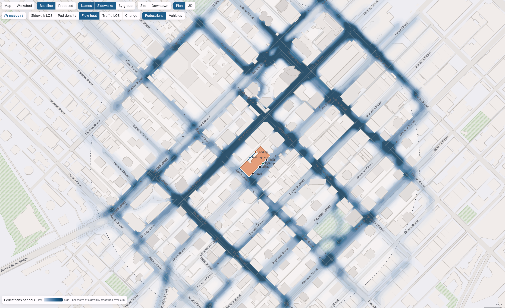

# Street Flow Lab

Pedestrian and vehicle traffic simulation around a downtown Vancouver massing: how a building's programme and its entrances load the sidewalks, crossings, lanes and junctions around it, compared with the lot as it is today.



Browser tool, no build step, no server-side code. Everything runs locally from `src/`.

## Run it

```
python tools/serve.py            # serves src/ on http://127.0.0.1:8765
```

Open http://127.0.0.1:8765/index.html. (Opening `index.html` directly from disk also works in Edge/Chrome; the server only matters for correct UTF-8 headers.)

## Workflow

The map shows the whole downtown peninsula (every street, building and park in the data); the circle is the simulated study area. Four stages in the top bar and a run bar that is always there. The map bar has one row before a run (Map or Walkshed, Baseline or Proposed, layers, zoom, Plan or 3D); a second **Results** row with the result layers (Sidewalk LOS, Ped density, Flow heat, Traffic LOS, Change) appears only once a run exists.

1. **Site** — click any lot on the map or search an address. The study area (default 450 m) is built from OpenStreetMap streets, sidewalks, crossings, signals and stops, plus every neighbouring building with an estimated floor area and use. Sliders set how busy the surroundings are.
2. **Building** — the massing as blocks (use, footprint, floors) or an imported Downtown Massing Tool project; the programme it implies with editable trip rates; entrances, parking ramp, loading and pick-up kerb; public realm: places to stay (plaza, seating, playground, terrace, arcade, garden) and through-block walkways.
3. **People** — eight user groups (speed, stairs, schedule, transit/car habits, how long they stop) and who comes with each use, with an hour-by-hour preview.
4. **Run** (top bar) — pick a window (AM, midday, PM, evening, custom) and press Run: baseline (today) and proposed share the same background random stream. **Watch** animates one scenario; *By group* colours pedestrians by user group.
5. **Results** — a headline (does the building hurt the street, and where), *Compare scenarios* (street stress today, for the project without its public realm, and with it; and across the four time windows), KPI tiles, sidewalk/crossing and link tables, junction delay chart, *Who is here* (who walks past, who stays where), walksheds, map modes (Sidewalk LOS, Ped density, Traffic LOS, Change, Walkshed), CSV / JSON export and a printable report. The right panel shows an at-a-glance summary, or the numbers of whatever you click on the map.

**Flow heat** (map mode, after a run) is a smoothed raster of hourly pedestrian flow per metre of sidewalk, or vehicles per street link, blurred over about 6 m so corridors read as corridors. **3D** (map bar) tilts the same map into a parallel projection: the surrounding buildings rise as prisms from the OpenStreetMap and City of Vancouver footprints with their heights, the massing blocks rise from the lot, and in every results mode the flow is drawn as ribbons whose height is the flow and whose colour is the mode's (LOS grade, density, heat, change). Drag pans, right-drag or Shift-drag orbits, `[` `]` rotate, `{` `}` tilt; the Plan button returns. The printable report includes a 3D heat figure.

**What each use does to the street** (Results) splits the project's people on foot, cars, kerb pick-ups and deliveries in the window by use, from the trip rates; *Attribute by simulation* then runs the project once without each use and reports the change in street stress, people, vehicles, worst junction delay and frontage grade, so the effect of the programme is measured rather than inferred.

**Advanced · Inside the tower** (Building tab) reads the stack from the blocks (level by level, with each use's floor area), puts the same trip generation on the lifts floor by floor (car arrivals board at the parking levels, a share of trips to L2–L3 take the stairs, a share of amenity, café and shop use is internal), and sizes the lift group with an up-peak round-trip model: probable stops, highest reversal floor, interval, handling capacity against the peak five-minute demand, lobby wait and queue, plus what one or two more lifts or a two-zone split would do. It then critiques the placement: visitor uses above the lobby, a residents' amenity high in the tower, homes and offices on one group, parking rides, lobby crowding. Lifts, capacity, speed, door time and the two shares are editable; blank means automatic. The report has a page for it.

**Street stress** is the peak 15-minute sidewalk rate (p/min/m) each pedestrian meets, averaged over everyone on sidewalks within 200 m of the site, weighted by flow. It is a single comparative number in the spirit of KPF Urban Interface's One Vanderbilt study (existing conditions, added commuter demand, relief from the public realm); it is not a standard and not an approval metric.

Projects auto-save to the browser (localStorage) and can be saved/opened as JSON (`Save` / `Open…`).

Changing any setting after a run keeps the last results on screen, marked **Settings changed** with a dot on the Run button, until the next run replaces them. Removing a block, entrance, walkway or place, clearing the blocks, or opening a file can be undone from the notice that appears at the bottom of the map.

Keyboard: `R` runs, `1`–`4` switch stages, `Esc` cancels picking a lot. **Basic / Advanced** in the top bar: Basic shows the essentials; Advanced adds the surroundings sliders, the data note, trip rates and mode split, Inside the tower, the group mix, the simulation settings, per-use attribution by simulation, the by-group layer and the 3D camera buttons. The choice is remembered. With the map focused, arrow keys pan, `+`/`-` zoom, `Enter` selects the sidewalk or junction at the centre mark and `Escape` clears it. Rows in the Results tables are focusable and select with `Enter`.

## Look

The Tower Design Toolkit design system (its `DESIGN_HANDOFF.md`, 0.1), so the tool sits in the same family as the toolbench: paper `#f6f5f2`, white panels, ink `#1f2328`, line `#e3e1dc`, muted `#62666d`, one accent blue `#1f5f8b`; Inter at 12 px for body and controls, 11 px uppercase tracked section headers, tabular numerals; a 56 px top bar with the in-app mark and stage tabs (icon, label, subtitle, key), 22 rem / 18 rem side panels, and a 32 px status bar with the evidence legend, the data credits and "Design-stage estimate, not a traffic impact assessment". Evidence is always icon + word: **Verified** (published data), **Team assumption** (an editable rate or share) and **Estimate** (a simulated or derived number, on the hatched chip); sections and the Results headline carry one. Program colours follow the toolkit (retail `#e3a07a`, office `#6b8fb5`, hotel `#e8b84a`, residential `#9bbf85`, civic `#b48ac4`, amenity `#6cc0b8`, plant `#a3a3a3`); charts use its node-category colours; grades run on a ramp of the accent blue with E and F in the toolkit's view-cone amber and red. The map keeps the architectural drawing language (kerb lines, hairline outlines, hatched parks and shadow walls) on the toolkit's clay 3D look (`#eef0f2` background, `#e7e6e1` ground, `#f7f3ea` site, `#f1efea` context, `#b9b6ae` edges). Motion: 100 ms feedback, 200 ms stage cross-fade, `cubic-bezier(0.2, 0, 0, 1)`, a reduced-motion toggle in the top bar plus the OS setting, and a live announcement on every stage change. Everything is a token in `src/index.html` (`:root` light, two dark blocks) or the palette at the top of `src/charts.js`; the canvas reads the tokens live.

## Files

- `src/index.html` — layout, CSS tokens (light/dark), script order.
- `src/geom.js` — vector/polygon helpers, spatial grid, RNG, heap.
- `src/site.js` — parcels, the lot frame (identical to the Downtown Massing Tool, so imports align), context buildings, parks, right-of-way widths.
- `src/net.js` — network build: directed vehicle graph with signal phases; undirected pedestrian graph from OSM sidewalks/crossings/paths with synthetic sidewalks where OSM has none; doors, walkways, gates; shortest-path trees with route variants.
- `src/demand.js` — trip generation (rates, hourly profiles, mode split), context generators, destination choice, background traffic, expected agent counts.
- `src/sim.js` — the engine: pedestrian agents (density-dependent speed, signal-tied crossing waits), vehicle agents (point queues with storage/spillback, signals, priority, all-way stop, kerb dwell for deliveries and pick-ups), 15-minute records.
- `src/analysis.js` — LOS grading (HCM sidewalk flow, HCM control delay, v/c), KPIs, scenario comparison, walkshed.
- `src/vt.js` — inside the tower: the stack from the blocks, lift demand per floor, the up-peak round-trip lift model, placement advice, the stack figure.
- `src/charts.js` — SVG charts + palette (data-viz method: fixed categorical order, one-hue LOS ramp, diverging change ramp).
- `src/views.js` — the map canvas (context, massing, networks, agents, overlays, hover/select, snapshots).
- `src/report.js` — printable report.
- `src/app.js` — state, panels, run loop, import/export, self-test.
- `src/city-data.js` — City of Vancouver open data (parcels, streets, ROW widths, parks, zoning), copied from the Downtown Massing Tool.
- `src/osm-data.js` — OpenStreetMap building footprints (copied from the Downtown Massing Tool).
- `src/osm-streets.js` — OpenStreetMap highways, crossing/signal nodes, stops (`tools/fetch-osm-streets.py`).

## Tools

- `tools/fetch-osm-streets.py [--refresh]` — Overpass download → `src/osm-streets.js` (raw cache in `docs/osm-streets-raw.json`).
- `tools/fetch-osm-buildings.py [--refresh]` — Overpass download of building footprints and parts with heights (`height`, `building:levels`) → `src/osm-data.js`, the context model for the map and the 3D view (raw cache in `docs/osm-raw.json`).
- `tools/fetch-city-footprints.py [--refresh] [--dry-run] [--dataset NAME]` — City of Vancouver Open Data Portal (`building-footprints-2009`, LiDAR heights above ground) → replaces the `foot` layer of `src/city-data.js`, which fills in heights where OpenStreetMap has none (raw cache in `docs/city-footprints-raw.json`).
- `tools/serve.py [port]` — local server.
- `tools/jscheck.py` — syntax check of all modules with esprima (no Node on this machine).
- `tools/headless.ps1 -Hash selftest` — boots in headless Edge and prints the self-test (`#selftest`). `-Hash run:pedLos|vehLos|change|report` runs both scenarios and screenshots with `-Shot path.png`; `-Hash run:stale` runs and then changes a setting, to see the stale-results state; `-Hash run:realm` / `run:day` / `run:uses` run and then the public-realm, across-the-day or per-use attribution; `-Hash tab:tower` opens the Building tab on the Inside-the-tower section; `run:heat`, `run:heatveh`, and any mode with a `3d` suffix (`run:heat3d`, `run:pedLos3d`) show the heat map and the 3D view; append `+site` to zoom to the lot; `-Hash tab:building|people|results` screenshots a panel; `-Hash watch` / `watchg` the live animation (coloured by group); `-Hash downtown` the zoomed-out map. Append `+dark` to any hash (`run:pedLos+dark`) for the tool's own dark theme; `-Dark` instead forces Edge's auto-dark rendering, which recolours the page and is not what users see.

## Limits

Design-stage estimates, not a traffic impact assessment. Routes are shortest-path with random variants (no congestion feedback); signals are generic two-phase 80 s cycles; vehicle turning conflicts are simplified; neighbouring building uses are inferred from zoning and shape; trip rates are downtown-calibrated defaults. Calibrate against counts before quoting numbers. Method details and thresholds: `docs/METHOD.md`.
